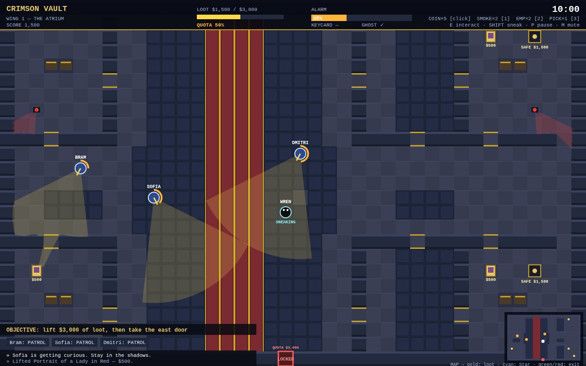

# heist-game-20261122

**CRIMSON VAULT — 3 wings, 10 guards, 8 cameras, 22 loot, 1 diamond.**
A top-down heist in the Meridian Museum: cross the room under sweeping
vision cones, lift the art, crack the safes, take the keycard, open the
vault, steal the Meridian Star — and reach the getaway van before the
10-minute clock runs out. Entered on
[make.fun](https://make.fun/bounty/best-heist-game-20261122-0559).

- **3 hand-built wings** — The Atrium, The Gallery, The Vault — each a full
  room in one frame: red-carpet routes, shadow carpets, display tables,
  a fountain, doorways, and a locked east door.
- **10 named guards** (Bram, Sofia, Dmitri, Anya, Kofi, Mara, Jules, Petra,
  Omar, Lena) with five states: patrol, suspicious, chase, search, return.
  Suspicion fills while you stand in a cone and drains when you break line
  of sight; at 100 a guard chases, and a touch means caught.
- **8 sweeping security cameras** — seen by one feeds the alarm meter fast;
  cut a wall panel to kill a camera for 20 seconds, or burn an EMP to kill
  them all for 6.
- **22 loot + the Meridian Star ($10,000)** — paintings, crackable safes
  (hold E for 2 seconds, or spend a lockpick), the Vault Keycard in Wing 2,
  and the Star behind the vault door in Wing 3.
- **The alarm meter** — climbs while any guard or camera sees you, cools
  while you hide. At 70% the museum locks down and every guard converges;
  at 100% they all hunt. Finish with the alarm never past 50% for the
  GHOST bonus (+500).
- **Tools at a cost** — 5 coins a wing (click to toss one; the clink pulls
  guards), 2 smoke bombs (blind cones 4s), 2 EMPs, 1 lockpick. Running is
  fast and loud; sneaking is slow, quiet and half as visible; shadow
  carpet halves detection.
- **Sound, synthesized live** — footsteps, coin clinks, pickup chimes,
  the vault clunk, the spotted sting, the alarm hum. No audio files.

## Play

Open `game/index.html` in desktop Chrome (or serve `game/` with any
static server). Keyboard + mouse: WASD / arrows to move, Shift to sneak,
Space to run, click to toss a coin, E to interact, 1 smoke, 2 EMP,
3 lockpick, P pause, M mute.

## Layout

- `game/index.html` + `game/src/` — the game, plain static files, no
  network requests: `config.js` (tuning + the three hand-drawn maps),
  `level.js` (grid, line of sight, flood-fill validation), `guard.js`
  (patrol AI + vision cones), `camera.js` (sweeps + panels),
  `player.js` (movement + tools), `world.js` (loot, alarm, score, win /
  caught), `audio.js` (WebAudio synth), `render.js` (room, cones, HUD,
  minimap, screens), `shots.js` (the four staged screenshots),
  `main.js` (loop + input + screen flow).
- `screenshots/` — 4 real renders of the game's own code in a browser.
- `main.ts` — the make.fun entrypoint: copies `game/` + `screenshots/`
  to `/output` and writes `dossier.json` with the kit's library.
- `vendor/makefun-game.ts` — the kit's dossier library, unchanged.

## License

MIT — see [LICENSE](LICENSE).
